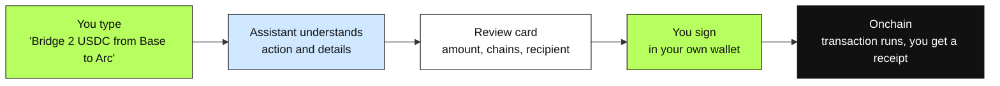
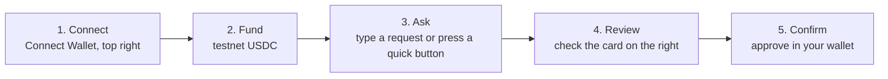
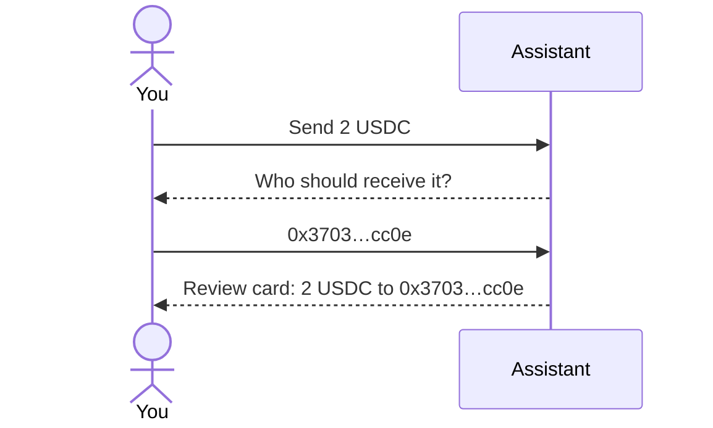
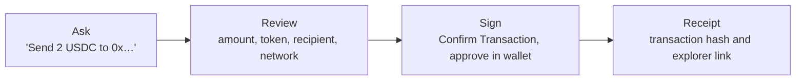
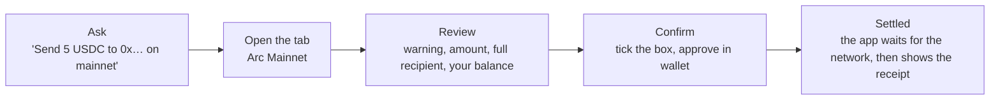
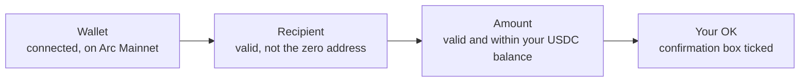
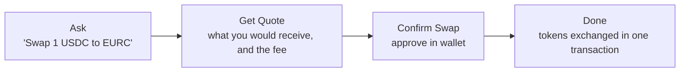
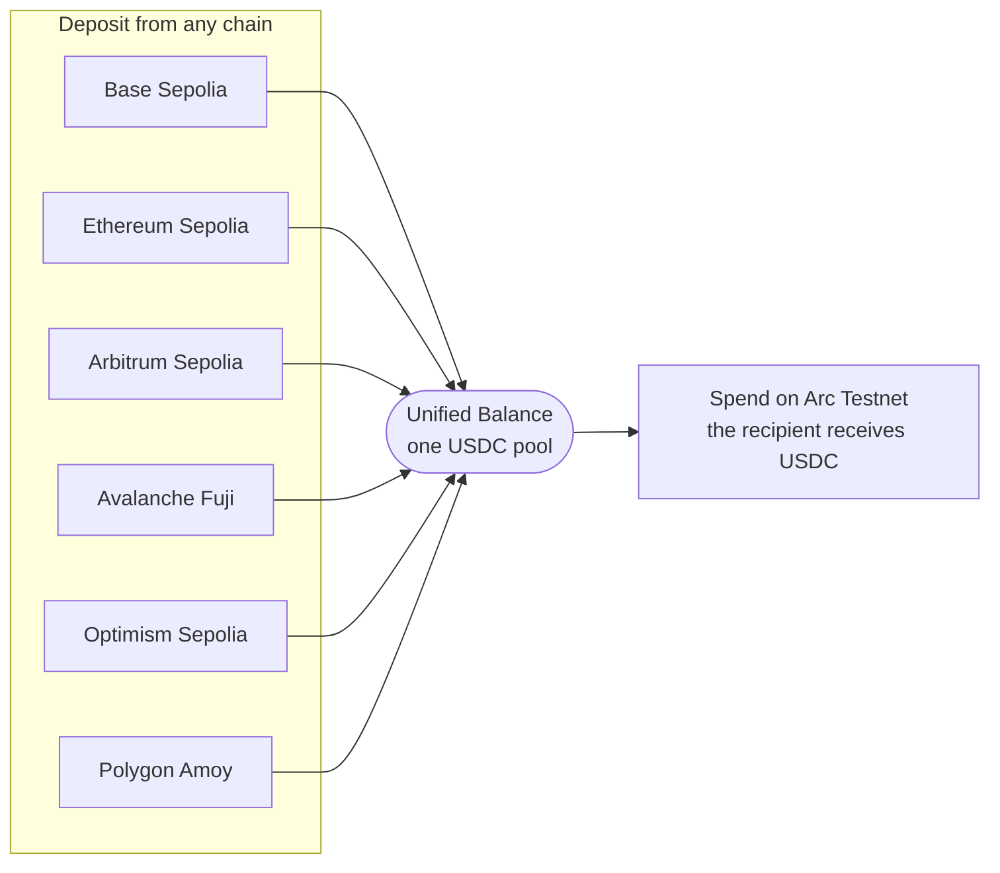
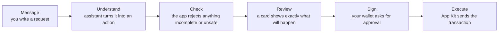
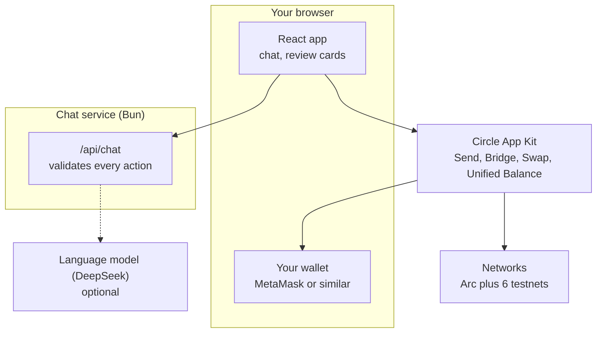

# AI Wallet for Arc

A chat-based wallet assistant for [Arc](https://www.arc.io). Type what you want to do, in any language, and the app prepares a transaction for you to review. You approve it with your own wallet. **The assistant never signs anything.**

Built by @gemresearches

| Actions | Networks | Asset | Signing |
| --- | --- | --- | --- |
| 4 (Send, Bridge, Swap, Unified Balance) | Arc Testnet plus 6 other testnets, Arc Mainnet for Send | USDC (EURC for Swap) | You, in your own wallet |

> **Mainnet warning.** Everything in this app runs on testnets with test tokens, except one feature: **Send on Arc Mainnet**, which moves real USDC. Mainnet transactions are real and cannot be undone. Test on Arc Testnet first, double-check every address, and get an independent review before relying on any code for real funds.

## Contents

- [Features](#features)
- [The big picture](#the-big-picture)
- [Getting started](#getting-started)
- [Using the app](#using-the-app)
- [How it works](#how-it-works)
- [Supported networks](#supported-networks)
- [Risks and limits](#risks-and-limits)
- [Architecture](#architecture)
- [Development](#development)
- [FAQ](#faq)

## Features

- **Send.** Send USDC to any address on Arc Testnet, or on Arc Mainnet with real funds (a separate tab with a warning and an explicit confirmation).
- **Bridge.** Move USDC between Arc Testnet and six other testnets.
- **Swap.** Swap between USDC and EURC on Arc Testnet, with a quote before you commit.
- **Unified Balance.** Deposit USDC from many chains into one balance, then spend it on Arc Testnet.
- **Chat in any language.** English, Vietnamese and more, with follow-up questions when something is missing.
- **Built-in documentation.** Open it from the **Docs** button at the top of the app. It has the same content as this file, with diagrams.

## The big picture



## Getting started

You need a browser wallet and a little testnet USDC. It takes about two minutes.



1. Install a browser wallet such as MetaMask and press **Connect Wallet**.
2. Arc uses USDC to pay network fees, so one balance covers both your transfers and your gas. Fund your wallet with testnet USDC from the Circle testnet faucet.
3. Type a request in the chat, for example `Send 1 USDC to 0x…`, or press a quick button.
4. Check the **Transaction Review** card on the right. Change the amount if you want.
5. Confirm. Your wallet asks you to sign. Nothing happens before that.

## Using the app

### Chat assistant

Talk to the assistant the way you would talk to a person. You do not need special commands.

- `Send 1 USDC to 0x468867c8…`
- `Bridge 2 USDC from Base Sepolia to Arc`
- `Swap 1 USDC to EURC`
- `Deposit 3 USDC from Arbitrum to my unified balance`
- `chuyển 2 usdc từ base sang arc` (any language works)

The assistant remembers the recent conversation. If you leave something out, it asks for exactly that detail, and you can reply with just the missing part:



Built-in safety checks:

- A review card only appears when every detail is complete.
- Wallet addresses must be ones you typed yourself. The assistant cannot invent a recipient.
- Source and destination chains must be different for a bridge.

### Send

Send USDC from your wallet to another address.



- Send has two tabs: **Arc Testnet** (default, test money) and **Arc Mainnet**.
- Try Arc Testnet first, or send a small amount to a new address before a large one.
- Check the recipient carefully. Onchain transfers cannot be undone.
- The network fee is paid in USDC.

### Send on Arc Mainnet

Send real USDC to another address on Arc Mainnet. This is the only feature in the app that works with real funds.



Checks before anything is sent:



If a check fails, the Send button stays locked and the card says why.

1. Open the Send card and choose the **Arc Mainnet** tab. Typing "mainnet" in the chat opens it for you.
2. Read the red banner, then check the amount, the full recipient address and your balance.
3. Tick the box to confirm that you checked the recipient and the amount and that the transfer cannot be undone.
4. Press **Send on Arc Mainnet** and approve in your wallet. Your wallet may first ask to add or switch to Arc Mainnet.
5. Wait for the network to confirm. The card shows the receipt and an explorer link when it is final. If the transfer fails, the card says so instead of showing success.

Good to know:

- You need real USDC on Arc Mainnet. Test USDC from Arc Testnet does not work here.
- The network fee is paid in USDC from the same balance, so keep a little extra beyond the amount you send.
- Amounts above 100 USDC show an extra warning.
- The chat only prepares the card. It never signs, and it never picks the recipient.
- Mainnet is available for **Send only**. Swap, Bridge and Unified Balance stay on testnets.

### Bridge

Move USDC between Arc Testnet and six other testnets.

- The review card shows each step and links to the explorer.
- Settlement can take a few minutes. Keep the page open.
- Your wallet may ask to switch networks. This is normal. If a network is missing, your wallet offers to add it.

### Swap

Swap between USDC and EURC on Arc Testnet. You see a quote first and decide whether to go ahead.



- Slippage tolerance is 3%. The swap fails if the price moves more.
- Swaps are routed through a third-party aggregator (currently LiFi), which may change over time. Its terms of service apply.
- On Arc, USDC and the native gas token are the same asset, so there is nothing to swap between them.
- Quotes are estimates. The final amount can differ slightly.

### Unified Balance

Hold USDC on several chains and use it as one balance. Deposit from any supported chain, then spend on Arc Testnet.



**Deposit.** Pick the source chain and the amount. The app switches your wallet to that chain, adds the network if your wallet does not have it, and asks you to sign. The panel shows your total and the balance on each chain.

**Spend.** Enter the amount and the recipient. You do not choose which chains supply the USDC. The app picks them for you:

1. It draws from Arc Testnet first, because that is where the money is delivered.
2. If more is needed, it takes from your other chains, largest balance first.
3. Fees depend on the route and are applied automatically.

A deposit becomes spendable once it is confirmed. Recent deposits can take a little while to show up in the total.

## How it works

Every request goes through the same path, so you always know what will happen before you sign.



Who is in control:

| The assistant can | Only you can |
| --- | --- |
| Understand your message | Connect your wallet |
| Ask for missing details | Check the review card |
| Prepare a review card | Approve and sign in your wallet |
| | Decide whether anything is sent |

## Supported networks

Every network is a testnet, except Arc Mainnet, which is available for Send only. Arc Testnet is the home network of the app.

| Network | Used for |
| --- | --- |
| **Arc Mainnet** | Send only (real funds) |
| **Arc Testnet** | Send, Swap, Bridge, Unified Balance spend |
| **Base Sepolia** | Bridge, Unified Balance deposit |
| **Ethereum Sepolia** | Bridge, Unified Balance deposit |
| **Arbitrum Sepolia** | Bridge, Unified Balance deposit |
| **Avalanche Fuji** | Bridge, Unified Balance deposit |
| **Optimism Sepolia** | Bridge, Unified Balance deposit |
| **Polygon Amoy** | Bridge, Unified Balance deposit |

Arc is Circle's blockchain where USDC is the native gas token. Fees are paid in USDC and transactions finalize in under a second.

## Risks and limits

**Safety**

- The assistant never has access to your keys or funds.
- Every transaction needs your signature in your own wallet.
- Recipient addresses come from what you type, never from the assistant.

**Limits**

- Arc Mainnet is available for Send only. Everything else is testnet.
- Swap runs on Arc Testnet and supports USDC and EURC. Send runs on Arc Testnet and Arc Mainnet.
- Unified Balance spends are delivered on Arc Testnet.
- Bridge and Unified Balance handle USDC only.

**Risks to keep in mind**

- Onchain transactions are final. Double-check the recipient and the amount on the review card.
- Swap quotes are estimates and prices can move before you sign.
- Bridges and deposits take time. Do not close the page while one is running.

Before using any similar app with real money, get an independent review. This app is a testnet demo, apart from the clearly marked Send on Arc Mainnet tab.

## Architecture

A React front end, a small chat service, and Circle App Kit for every onchain action.



- **React app.** The chat, the review cards and the wallet button.
- **Chat service.** Receives each message with the recent conversation, asks the language model for an action, and validates the result before the app sees it.
- **Circle App Kit.** Runs Send, Bridge, Swap and Unified Balance with the wallet you connected. Mainnet Send is a standard USDC transfer from your wallet.

## Development

Prerequisites: [Bun](https://bun.sh) and a browser wallet.

```bash
bun install
bun run server   # chat API on port 3001
bun run dev      # web app on port 5173 (proxies /api to the chat API)
```

Other scripts: `bun run check` runs lint and typecheck.

### Environment variables

| Name | Purpose |
| --- | --- |
| `DEEPSEEK_API_KEY` | Optional. Lets the assistant understand free-form messages in any language. Without it, a built-in parser handles common English commands. The key stays on the server, so never prefix it with `VITE_`. |

Create a `.env` file in the project root to set it. Restart the chat service (`bun run server`) after changing `.env`, because it reads the file only at startup. Never commit `.env`.

## FAQ

**Does the assistant hold my funds?**
No. Your funds stay in your wallet. The assistant only prepares a request, and nothing moves until you sign.

**Why does my wallet ask to switch or add a network?**
Bridge and Unified Balance deposits sign on the source chain, so the wallet must be on that chain. If it is missing, your wallet offers to add it.

**Why was I asked for more details?**
The assistant only shows a review card when the amount, the chains and the recipient are all clear. Reply with the missing detail.

**I see two USDC balances on Arc. Which is real?**
They are the same money shown two ways. Arc uses USDC as its gas token, so wallets may show it with more decimals. Count it once.

**My bridge is still pending.**
Cross-chain transfers can take a few minutes. Open the explorer link on the review card to follow progress.

**Can I use real money in this app?**
Only for Send on Arc Mainnet. It has its own tab with a warning and a confirmation box. Everything else runs on testnets with test tokens.

**Do I need an API key to use the app?**
No. The AI key is optional and only improves how well the assistant understands free-form text.
